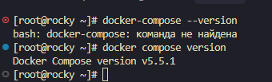

 ## Кононенко Александр   задание     Практическое применение Docker. Часть 2

### Задача 0

<details>
<summary><strong>Текст Задачи</strong></summary>

1. Убедитесь что у вас НЕ(!) установлен `docker-compose`, для этого получите следующую ошибку от команды `docker-compose --version`:

   ```text
   Command 'docker-compose' not found, but can be installed with:

   sudo snap install docker          # version 24.0.5, or
   sudo apt  install docker-compose  # version 1.25.0-1

   See 'snap info docker' for additional versions.


В случае наличия установленного в системе docker-compose - удалите его.

2. Убедитесь что у вас УСТАНОВЛЕН docker compose (без тире) версии не менее v2.24.X, для этого выполните команду docker compose version.
Своё решение к задачам оформите в вашем GitHub репозитории!!!!!!!!!!!!!!!!!!!!!!!!!!!!!!!!

</details>

### Решение 0

<details>
<summary><strong>Скрин Выполнения Команд</strong></summary>



</details>


### Задача 1
<details>
<summary><strong> Текст Задачи</strong></summary>

1. Сделайте в своем GitHub пространстве fork [репозитория](https://github.com/netology-code/shvirtd-example-python).

2. Создайте файл `Dockerfile.python` на основе существующего `Dockerfile`:
   - Используйте базовый образ `python:3.12-slim`.
   - Обязательно используйте конструкцию `COPY . .` в Dockerfile.
   - Создайте `.dockerignore` файл для исключения ненужных файлов.
   - Используйте `CMD ["uvicorn", "main:app", "--host", "0.0.0.0", "--port", "5000"]` для запуска.
   - Протестируйте корректность сборки.
   - **2.1.** Используйте multistage сборку вместо single stage.

3. (Необязательная часть, *) Изучите инструкцию в проекте и запустите web-приложение без использования docker, с помощью venv. (Mysql БД можно запустить в docker run).

4. (Необязательная часть, *) Изучите код приложения и добавьте управление названием таблицы через ENV переменную.

---

### ВНИМАНИЕ!

## !!! В процессе последующего выполнения ДЗ НЕ изменяйте содержимое файлов в fork-репозитории! Ваша задача ДОБАВИТЬ 5 файлов: `Dockerfile.python`, `compose.yaml`, `.gitignore`, `.dockerignore`,`bash-скрипт`. Если вам понадобилось внести иные изменения в проект - вы что-то делаете неверно!

</details>


### Решение 1

<details>
<summary><strong>Пункт1</strong></summary>

 ссылка на форк репозитория https://github.com/Alexkon22/shvirtd-example-python
</details>

<details>
<summary><strong>Пункт2</strong></summary>


```dockerfile
# Этап 1: сборка зависимостей
FROM python:3.12-slim AS builder
WORKDIR /app
COPY requirements.txt .
RUN python -m venv /opt/venv && \
    /opt/venv/bin/pip install --no-cache-dir -r requirements.txt

# Этап 2: готовый образ
FROM python:3.12-slim
WORKDIR /app
COPY --from=builder /opt/venv /opt/venv
ENV PATH="/opt/venv/bin:$PATH"
COPY . .
CMD ["uvicorn", "main:app", "--host", "0.0.0.0", "--port", "5000"]
```


Образ `shvirtd-web:v2` собирается в два этапа с помощью multistage-сборки.
Сначала на этапе `builder` устанавливаются все необходимые зависимости из `requirements.txt` в виртуальное окружение `/opt/venv`
Затем в готовый образ копируются готовое виртуальное окружение и код приложения исходя из этого в итоговом образе остаётся только то что нужно для запуска приложения и он получается легче и чище


