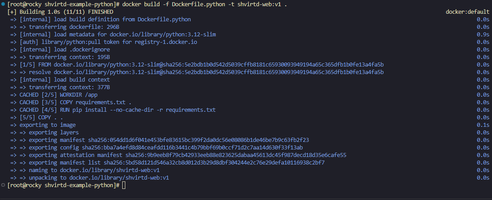
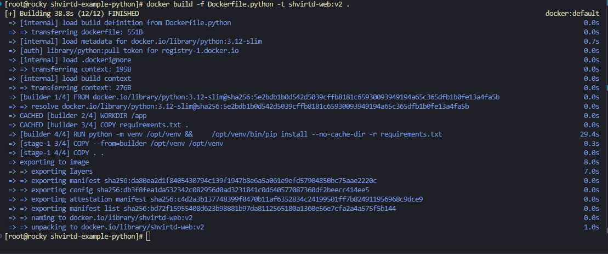
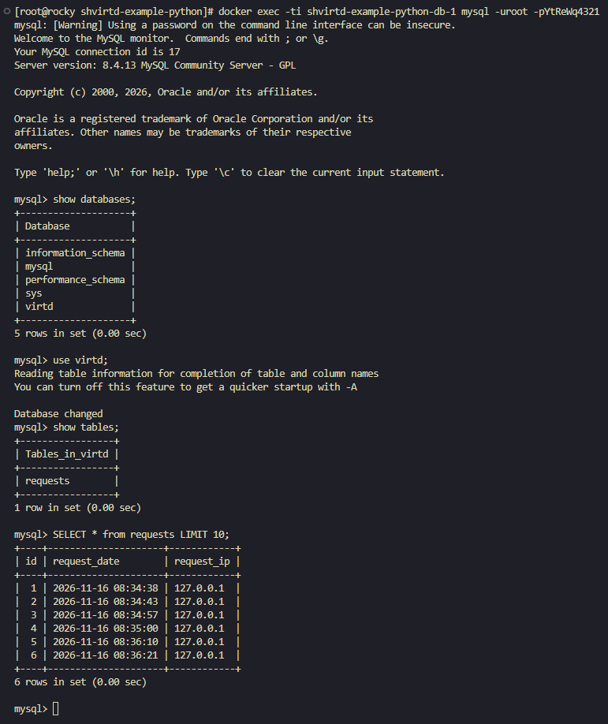

 ## Кононенко Александр   задание     Практическое применение Docker. Часть 2

### Задача 0

<details>
<summary><strong>Текст Задачи</strong></summary>

1. Убедитесь что у вас НЕ(!) установлен `docker-compose`, для этого получите следующую ошибку от команды `docker-compose --version`:

   ```text
   Command 'docker-compose' not found, but can be installed with:

   sudo snap install docker          # version 24.0.5, or
   sudo apt  install docker-compose  # version 1.25.0-1

   See 'snap info docker' for additional versions.


В случае наличия установленного в системе docker-compose - удалите его.

2. Убедитесь что у вас УСТАНОВЛЕН docker compose (без тире) версии не менее v2.24.X, для этого выполните команду docker compose version.
Своё решение к задачам оформите в вашем GitHub репозитории!!!!!!!!!!!!!!!!!!!!!!!!!!!!!!!!

</details>

### Решение 0

<details>
<summary><strong>Скрин Выполнения Команд</strong></summary>


</details>


### Задача 1
<details>
<summary><strong> Текст Задачи</strong></summary>

1. Сделайте в своем GitHub пространстве fork [репозитория](https://github.com/netology-code/shvirtd-example-python).

2. Создайте файл `Dockerfile.python` на основе существующего `Dockerfile`:
   - Используйте базовый образ `python:3.12-slim`.
   - Обязательно используйте конструкцию `COPY . .` в Dockerfile.
   - Создайте `.dockerignore` файл для исключения ненужных файлов.
   - Используйте `CMD ["uvicorn", "main:app", "--host", "0.0.0.0", "--port", "5000"]` для запуска.
   - Протестируйте корректность сборки.
   - **2.1.** Используйте multistage сборку вместо single stage.

3. (Необязательная часть, *) Изучите инструкцию в проекте и запустите web-приложение без использования docker, с помощью venv. (Mysql БД можно запустить в docker run).

4. (Необязательная часть, *) Изучите код приложения и добавьте управление названием таблицы через ENV переменную.

---

### ВНИМАНИЕ!

## !!! В процессе последующего выполнения ДЗ НЕ изменяйте содержимое файлов в fork-репозитории! Ваша задача ДОБАВИТЬ 5 файлов: `Dockerfile.python`, `compose.yaml`, `.gitignore`, `.dockerignore`,`bash-скрипт`. Если вам понадобилось внести иные изменения в проект - вы что-то делаете неверно!

</details>


### Решение 1

<details>
<summary><strong>Пункт 1</strong></summary>

Ссылка на форк репозитория: https://github.com/Alexkon22/shvirtd-example-python

</details>

<details>
<summary><strong>Пункт 2</strong></summary>

Создан файл `.dockerignore`, чтобы в образ не попадали лишние файлы и секреты (`.env`):

```
.git
.gitignore
.env
*.pdf
README.md
LICENSE
Dockerfile*
compose.yaml
proxy.yaml
nginx
haproxy
```

Для запуска используется `CMD ["uvicorn", "main:app", "--host", "0.0.0.0", "--port", "5000"]` (последняя строка в `Dockerfile.python`).

Проверка сборки: благодаря `.dockerignore` контекст сборки уменьшился со 151.87kB до 377B, а слои с зависимостями взялись из кэша (CACHED).



</details>

<details>
<summary><strong>Пункт 2.1</strong></summary>

```dockerfile
# Этап 1: сборка зависимостей
FROM python:3.12-slim AS builder
WORKDIR /app
COPY requirements.txt .
RUN python -m venv /opt/venv && \
    /opt/venv/bin/pip install --no-cache-dir -r requirements.txt

# Этап 2: готовый образ
FROM python:3.12-slim
WORKDIR /app
COPY --from=builder /opt/venv /opt/venv
ENV PATH="/opt/venv/bin:$PATH"
COPY . .
CMD ["uvicorn", "main:app", "--host", "0.0.0.0", "--port", "5000"]
```



Образ `shvirtd-web:v2` собирается в два этапа с помощью multistage-сборки.
Сначала на этапе `builder` устанавливаются все необходимые зависимости из `requirements.txt` в виртуальное окружение `/opt/venv`.
Затем в готовый образ копируются виртуальное окружение и код приложения. Благодаря этому в итоговом образе остаётся только то, что нужно для запуска приложения, и он получается легче и чище.

</details>


### Задача 3 

<details>
<summary><strong> Текст Задачи</strong></summary>

1. Изучите файл `proxy.yaml`.

2. Создайте в репозитории с проектом файл `compose.yaml`. С помощью директивы `include` подключите к нему файл `proxy.yaml`.

3. Опишите в файле `compose.yaml` следующие сервисы:

   - **`web`** — образ приложения должен ИЛИ собираться при запуске Compose из файла `Dockerfile.python` ИЛИ скачиваться из Yandex Cloud Container Registry (из задания № 2 со *).

     Контейнер должен работать в bridge-сети с названием `backend` и иметь фиксированный IPv4-адрес `172.20.0.5`.

     Сервис должен всегда перезапускаться в случае ошибок.

     Передайте необходимые ENV-переменные для подключения к MySQL базе данных по сетевому имени сервиса `db`.

   - **`db`** — `image: mysql:8`.

     Контейнер должен работать в bridge-сети с названием `backend` и иметь фиксированный IPv4-адрес `172.20.0.10`.

     Явно укажите перезапуск сервиса в случае ошибок.

     Передайте необходимые ENV-переменные для создания пароля root-пользователя, базы данных, пользователя и пароля для web-приложения.

     Обязательно используйте уже существующий `.env` file для назначения секретных ENV-переменных!

4. Запустите проект локально с помощью Docker Compose и добейтесь его стабильной работы.

   Команда:

   ```bash
   curl -L http://127.0.0.1:8090


должна возвращать в качестве ответа время и локальный IP-адрес.

Если сервисы не стартуют, воспользуйтесь командами:
docker ps -a
docker logs <container_name>


Если вместо IP-адреса вы получаете информационную ошибку — убедитесь, что вы отправляете запрос на порт 8090, а не 5000.
5. Подключитесь к БД MySQL с помощью команды:
   docker exec -ti <имя_контейнера> mysql -uroot -p<пароль root-пользователя>
   
   
   Обратите внимание: между ключом -u и логином root нет пробела. Это важно! То же самое касается пароля.
   
   Введите последовательно команды (не забывайте в конце ставить символ ;):
   show databases;
   use <имя вашей базы данных (по умолчанию virtd, как указано в .env)>;
   show tables;
   SELECT * from requests LIMIT 10;
   
   
   Примечание: таблица в БД создаётся после первого поступившего запроса к приложению.
6. Остановите проект.
   
   В качестве ответа приложите скриншот SQL-запроса.
</details>

### Решение 1

<details>
<summary><strong> Скрин SQl Запроса</strong></summary>




</details>
