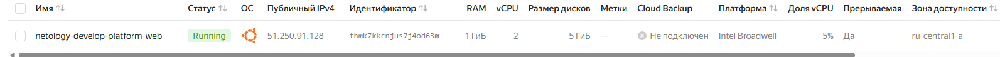
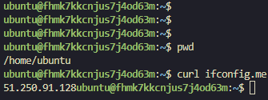
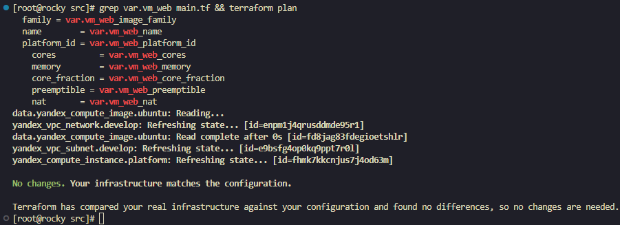
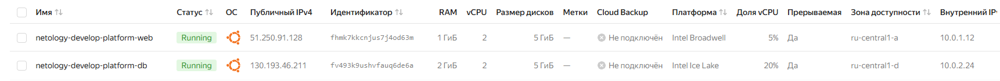
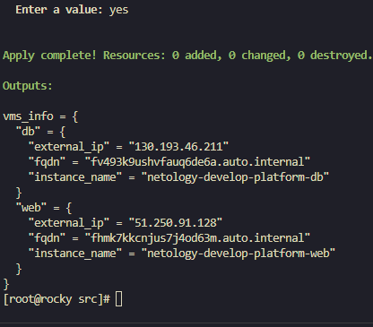
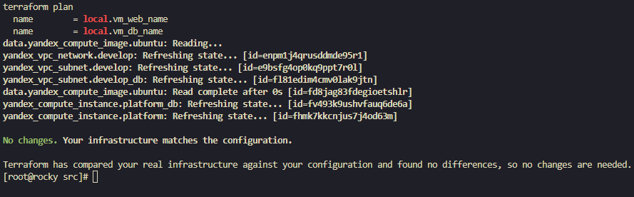
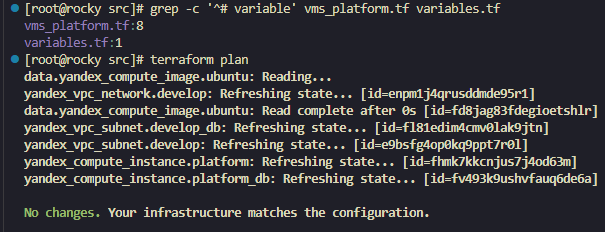

### Кононенко Александр Владимирович Домашнее задание к занятию «Основы Terraform. Yandex Cloud»

### Задание 1 


<details>
<summary> Текст Задания </summary>

В качестве ответа всегда полностью прикладывайте ваш terraform-код в git. Убедитесь что ваша версия **Terraform** ~>1.12.0

1. Изучите проект. В файле variables.tf объявлены переменные для Yandex provider.
2. Создайте сервисный аккаунт и ключ. [service_account_key_file](https://terraform-provider.yandexcloud.net/).
3. Сгенерируйте новый или используйте свой текущий ssh-ключ. Запишите его открытую(public) часть в переменную **vms_ssh_public_root_key**.
4. Инициализируйте проект, выполните код. Исправьте намеренно допущенные синтаксические ошибки. Ищите внимательно, посимвольно. Ответьте, в чём заключается их суть.
5. Подключитесь к консоли ВМ через ssh и выполните команду `curl ifconfig.me`. Примечание: К OS ubuntu "out of a box, те из коробки" необходимо подключаться под пользователем ubuntu: `"ssh ubuntu@vm_ip_address"`. Предварительно убедитесь, что ваш ключ добавлен в ssh-агент: `eval $(ssh-agent) && ssh-add` Вы познакомитесь с тем как при создании ВМ создать своего пользователя в блоке metadata в следующей лекции.;
6. Ответьте, как в процессе обучения могут пригодиться параметры `preemptible = true` и `core_fraction=5` в параметрах ВМ.

В качестве решения приложите:

- скриншот ЛК Yandex Cloud с созданной ВМ, где видно внешний ip-адрес;
- скриншот консоли, curl должен отобразить тот же внешний ip-адрес;
- ответы на вопросы.

</details>

---

#### Решение 1 
<details>
<summary> Текст Решения </summary>

суть ошибок заключается в следующем 
 * Суть ошибок:

1. `platform_id = "standart-v4"` — опечатка в слове `standard` и платформы `v4` в Yandex Cloud не существует Исправил на `standard-v1`.
2. `cores = 1` — платформа `standard-v1` поддерживает только 2 или 4 ядра Исправил на `cores = 2`.
3. `preemptible = true` — прерываемая виртуальная машина Облако может остановить её в любой момент если ресурсы понадобятся другим и в любом случае останавливает её через 24 часа Зато она в несколько раз дешевле обычной.
4. `core_fraction = 5` — гарантированная доля процессора 5%. Виртуальная машина постоянно получает только 5% времени ядра. Это тоже сильно снижает цену.

 
**скрины**


Виртуальная машина в консоли



Вывод `curl ifconfig.me`



</details>

---


### Задание 2 

<details>
<summary><strong>Текст задания </strong></summary>

1. Замените все хардкод-**значения** для ресурсов **yandex_compute_image** и **yandex_compute_instance** на **отдельные** переменные. К названиям переменных ВМ добавьте в начало префикс **vm_web_**. Пример: **vm_web_name**.
2. Объявите нужные переменные в файле `variables.tf`, обязательно указывайте тип переменной. Заполните их **default** прежними значениями из `main.tf`.
3. Проверьте `terraform plan`. Изменений быть не должно.

</details>

---

#### Решение 2
<details>
<summary><strong>Текст Решения </strong></summary>


Заменил все хардкод-значения для ресурсов `yandex_compute_image` и `yandex_compute_instance` на отдельные переменные с префиксом `vm_web_`  ввел  команду `terraform plan` изменений нет значит замена прошла корректно



</details>

---

### Задание 3 


<details>
<summary><b>Текст Задания </b></summary>

1. Создайте в корне проекта файл `vms_platform.tf`. Перенесите в него все переменные первой ВМ.
2. Скопируйте блок ресурса и создайте с его помощью вторую ВМ в файле `main.tf`: **"netology-develop-platform-db"**, `cores = 2`, `memory = 2`, `core_fraction = 20`. Объявите её переменные с префиксом `vm_db_` в том же файле (`vms_platform.tf`). ВМ должна работать в зоне `"ru-central1-b"`.
3. Примените изменения.

</details>

---

#### Решение 3

<details>
<summary><strong>Текст Решения </strong></summary>

1. Создал файл `vms_platform.tf` и перенёс в него все переменные первой ВМ (`vm_web_`).
2. Объявил переменные второй ВМ с префиксом `vm_db_` в том же файле и добавил в `main.tf` ресурс `netology-develop-platform-db` (cores = 2, memory = 2, core_fraction = 20).
3. Зона `ru-central1-b` в Yandex Cloud закрыта (ошибка `Zone ru-central1-b is not available`) поэтому вторая ВМ развёрнута в зоне `ru-central1-d в этой зоне нет платформы `standard-v1` использована `standard-v3`
4. Для второй ВМ создал отдельную подсеть `develop-db` (`10.0.2.0/24`) потому что подсеть в Yandex Cloud привязана к одной зоне.

**Скриншот**



</details>

---

### Задание 4

<details>
<summary><b>Текст Задания</b></summary>

1. Объявите в файле `outputs.tf` **один** output, содержащий: `instance_name`, `external_ip`, `fqdn` для каждой из ВМ в удобном лично для вас формате (**без хардкода!!!**).
2. Примените изменения.

В качестве решения приложите вывод значений IP-адресов команды `terraform output`.

</details>

---

#### Решение 4

<details>
<summary><strong>Текст Решения  </strong></summary>

Создал файл `outputs.tf` с одним output `vms_info` в котором для каждой ВМ выводятся `instance_name` `external_ip` и `fqdn` без ХАРДКОДА 




</details>

--- 

### Задание 5
<details>
<summary><b> Текст задания </b></summary>

1. В файле `locals.tf` опишите в **одном** local-блоке имя каждой ВМ, используйте интерполяцию `${..}` с **несколькими** переменными по примеру из лекции.
2. Замените переменные внутри ресурса ВМ на созданные вами local-переменные.
3. Примените изменения.

</details>


#### Решение 5

<details>
<summary><strong>Текст Решения  </strong></summary>

Создал `locals.tf` с одним блоком `locals`. Имена вирт машин собираются из нескольких переменных (компания окружение проект роль) через интерполяцию `${..}` В ресурсах  вирт машин заменил `var.vm_web_name` и `var.vm_db_name` на `local.vm_web_name` и `local.vm_db_name` `terraform plan` показал `No changes`




</details>

---

##  Задание 6
<details>
<summary><b> Текст задания </b></summary>

1. Вместо использования трёх переменных `.._cores`, `.._memory`, `.._core_fraction` в блоке `resources {...}` объедините их в единую map-переменную **`vms_resources`** и внутри неё конфиги обеих ВМ в виде вложенного `map(object)`.

   Пример из `terraform.tfvars`:

   ```hcl
   vms_resources = {
     web = {
       cores         = 2
       memory        = 2
       core_fraction = 5
       hdd_size      = 10
       hdd_type      = "network-hdd"
       ...
     },
     db = {
       cores         = 2
       memory        = 4
       core_fraction = 20
       hdd_size      = 10
       hdd_type      = "network-ssd"
       ...
     }
   }
   ```

2. Создайте и используйте отдельную `map(object)` переменную для блока `metadata`, она должна быть **общая** для всех ваших ВМ.

   Пример из `terraform.tfvars`:

   ```hcl
   metadata = {
     serial-port-enable = 1
     ssh-keys           = "ubuntu:ssh-ed25519 AAAAC..."
   }
   ```

3. Найдите и закомментируйте все более не используемые переменные проекта.
4. Проверьте `terraform plan`. Изменений быть не должно.

</details>

---


#### Решение 6

<details>
<summary><strong>Текст Решения  </strong></summary>

### Решение 6

1. Объединил переменные `cores` `memory` `core_fraction` обеих ВМ в одну переменную `vms_resources` типа `map(object)` с ключами `web` и `db` В ресурсах используется `var.vms_resources["web"]cores` 
2. Создал общую для всех ВМ переменную `metadata` (`serial-port-enable` и `ssh-keys`) Её значение с ssh-ключом хранится в `personal.auto.tfvars` который не попадает в git В ресурсах указано `metadata = var.metadata`
3. Закомментировал неиспользуемые переменные: `vm_web_/vm_db_` `cores `memory` `core_fraction` `name` а также `vms_ssh_root_key`
4. `terraform plan` показал `No changes




</details>


