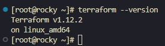
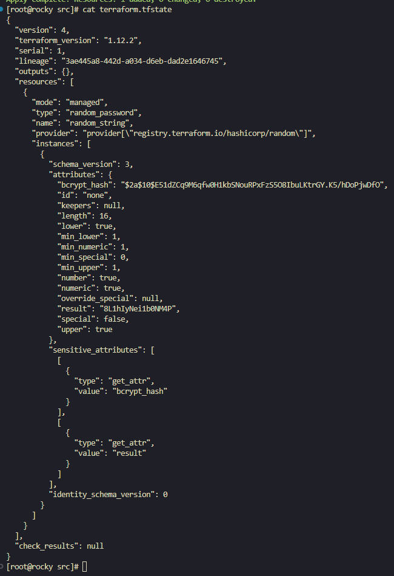
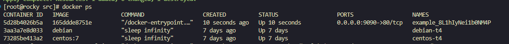

### Кононенко Александр      Домашнее задание к занятию «Введение в Terraform»

### Задание 1


<details>
<summary><strong> Текст Задания</strong></summary>

1. Перейдите в каталог [**src**](https://github.com/netology-code/ter-homeworks/tree/main/01/src). Скачайте все необходимые зависимости, использованные в проекте.

2. Изучите файл **`.gitignore`**. В каком terraform-файле, согласно этому `.gitignore`, допустимо сохранить личную секретную информацию (логины, пароли, ключи, токены и т. д.)?

3. Выполните код проекта. Найдите в state-файле секретное содержимое созданного ресурса **`random_password`**. Пришлите в качестве ответа конкретный ключ и его значение.

4. Раскомментируйте блок кода, примерно расположенный на строчках 29–42 файла **`main.tf`**. Выполните команду `terraform validate`. Объясните, в чём заключаются намеренно допущенные ошибки. Исправьте их.

5. Выполните код. В качестве ответа приложите:
   - Исправленный фрагмент кода.
   - Вывод команды `docker ps`.

6. Замените имя Docker-контейнера в блоке кода на `hello_world`. Не перепутайте имя контейнера и имя образа. Мы всё ещё продолжаем использовать `name = "nginx:latest"`.

   Выполните команду:

   ```bash
   terraform apply -auto-approve
   ```


Объясните своими словами, в чём может быть опасность применения ключа -auto-approve. Догадайтесь или найдите в интернете, зачем может пригодиться данный ключ.

В качестве ответа дополнительно приложите вывод команды docker ps.
7. Уничтожьте созданные ресурсы с помощью Terraform. Убедитесь что все ресурсы удалены.
   
   Приложите содержимое файла terraform.tfstate.
8. Объясните, почему при этом не был удалён Docker-образ nginx:latest.
   
   Ответ ОБЯЗАТЕЛЬНО НАЙДИТЕ В ПРЕДОСТАВЛЕННОМ КОДЕ, а затем ОБЯЗАТЕЛЬНО ПОДКРЕПИТЕ строчкой из документации Terraform провайдера Docker.
   
   Ищите в классификаторе ресурс docker_image.

</details>
   

### Решение 
<details>
<summary><strong> Скриншот Версии</strong></summary>



</details>

<details>
<summary><strong> Пункт2</strong></summary>

Секреты допустимо хранить в файле  `personal.auto.tfvars` он указан в `.gitignore` (`# own secret vars store`) и не попадёт в репозиторий  на GitHub 
так как git его не отслеживает 
</details>


<details>
<summary><strong> Пункт3</strong></summary>

содержимое созданного ресурса random_password `random_password` хранится в ключе `result`:
`"result": "8L1hIyNei1b0NM4P"`

 
</details>


<details>
<summary><strong> Пункт4</strong></summary>
 
После раскомментирования `terraform validate`  обнаружились  следующие ошибки 
1. `Missing name for resource` — у ресурса `docker_image` не было имени. В Terraform каждый ресурс описывается двумя метками: тип и имя (`resource "тип" "имя"`) Имя нужно, чтобы ссылаться на ресурс из других блоков Контейнер обращается к образу как `docker_image.nginx` поэтому я добавил имя `nginx`

2. `Invalid resource name` — имя контейнера `1nginx` начинается с цифры а имя ресурса должно начинаться с буквы или `_`. Имя исправил на `nginx`

3. `Reference to undeclared resource` — в имени контейнера была ссылка на `random_password.random_string_FAKE`  такого ресурса нет пароль объявлен как `random_password.random_string` Убрал `_FAKE`

4. `resulT` — неправильный регистр Terraform различает большие и маленькие буквы атрибут называется `result` Исправил на `result`.

</details>


<details>
<summary><strong> Пункт5</strong></summary>
Фрагмент кода 

```hcl
resource "docker_image" "nginx" {
  name         = "nginx:latest"
  keep_locally = true
}

resource "docker_container" "nginx" {
  image = docker_image.nginx.image_id
  name  = "example_${random_password.random_string.result}"

  ports {
    internal = 80
    external = 9090
  }
}
```
 скриншот вывода команды 


 </details>

<details>
<summary><strong> Пункт5</strong></summary>

</details>
