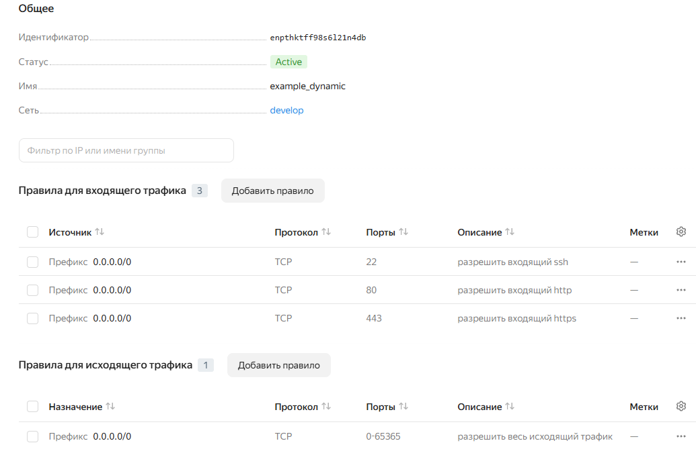

### Кононенко Александр Домашняя работа по теме   Управляющие конструкции в коде Terraform


### Задание 1
<details>
<summary>Текст задания</summary>
1. Изучите проект.
2. Инициализируйте проект, выполните код.
Приложите скриншот входящих правил «Группы безопасности» в ЛК Yandex Cloud.
</details>


#### Решение 1
<details>
<summary> Скриншот Решения</summary>

 *  Создал входящие правила группы безопасности (SSH 22, HTTP 80, HTTPS 443)





</details>

---

## Задание 2

<details>
<summary>Текст задания</summary>

1. Создайте файл count-vm.tf. Опишите в нём создание двух **одинаковых** ВМ web-1 и web-2 (не web-0 и web-1) с минимальными параметрами, используя мета-аргумент **count loop**. Назначьте ВМ созданную в первом задании группу безопасности (как это сделать, узнайте в документации провайдера yandex/compute_instance).
2. Создайте файл for_each-vm.tf. Опишите в нём создание двух ВМ для баз данных с именами "main" и "replica" **разных** по cpu/ram/disk_volume, используя мета-аргумент **for_each loop**. Используйте для обеих ВМ одну общую переменную типа:

```hcl
variable "each_vm" {
  type = list(object({ vm_name=string, cpu=number, ram=number, disk_volume=number }))
}
```

При желании внесите в переменную все возможные параметры.

3. ВМ, описанные в файле count-vm.tf, должны создаваться после ВМ, описанных в файле for_each-vm.tf.
4. Используйте функцию file в local-переменной для считывания ключа ~/.ssh/id_rsa.pub и его последующего использования в блоке metadata, взятому из ДЗ 2.
5. Инициализируйте проект, выполните код.

</details>

### Решение 2


</details>
---
