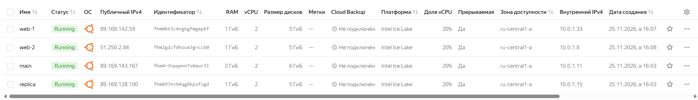
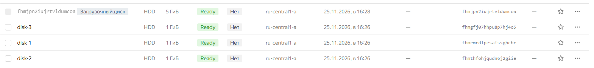

### Кононенко Александр Домашняя работа по теме   Управляющие конструкции в коде Terraform


### Задание 1
<details>
<summary>Текст задания</summary>
1. Изучите проект.
2. Инициализируйте проект, выполните код.
Приложите скриншот входящих правил «Группы безопасности» в ЛК Yandex Cloud.
</details>


#### Решение 1
<details>
<summary> Скриншот Решения</summary>

 *  Создал входящие правила группы безопасности (SSH 22, HTTP 80, HTTPS 443)


</details>

---

### Задание 2

<details>
<summary>Текст задания</summary>

1. Создайте файл count-vm.tf. Опишите в нём создание двух **одинаковых** ВМ web-1 и web-2 (не web-0 и web-1) с минимальными параметрами, используя мета-аргумент **count loop**. Назначьте ВМ созданную в первом задании группу безопасности (как это сделать, узнайте в документации провайдера yandex/compute_instance).
2. Создайте файл for_each-vm.tf. Опишите в нём создание двух ВМ для баз данных с именами "main" и "replica" **разных** по cpu/ram/disk_volume, используя мета-аргумент **for_each loop**. Используйте для обеих ВМ одну общую переменную типа:

```hcl
variable "each_vm" {
  type = list(object({ vm_name=string, cpu=number, ram=number, disk_volume=number }))
}
```

При желании внесите в переменную все возможные параметры.

3. ВМ, описанные в файле count-vm.tf, должны создаваться после ВМ, описанных в файле for_each-vm.tf.
4. Используйте функцию file в local-переменной для считывания ключа ~/.ssh/id_rsa.pub и его последующего использования в блоке metadata, взятому из ДЗ 2.
5. Инициализируйте проект, выполните код.

</details>

---

#### Решение 2

<details>
<summary>Текст решения </summary>


1. Создал `count-vm.tf`: ВМ `web-1` и `web-2` через `count`, с группой безопасности из задания 1
2. Создал `for_each-vm.tf`: ВМ `main` и `replica` через `for_each` и переменную `each_vm` Web создаются после них используя `depends_on`.
3. Ключ читается через `file()` в `locals.tf` (у меня `id_ed25519.pub` вместо `id_rsa.pub`)


**Скриншот**




</details>


---


## Задание 3

<details>
<summary>Текст задания</summary>

1. Создайте 3 одинаковых виртуальных диска размером 1 Гб с помощью ресурса `yandex_compute_disk` и мета-аргумента count в файле **disk_vm.tf**
2. Создайте в том же файле **одиночную** (использовать count или for_each запрещено из-за задания №4) ВМ c именем "storage". Используйте блок **dynamic secondary_disk{..}** и мета-аргумент for_each для подключения созданных вами дополнительных дисков.

</details>

### Решение 3

<details>
<summary>Текст Решения </summary>

1. Создал `disk_vm.tf`: 3 одинаковых диска `disk-1`, `disk-2` и `disk-3` по 1 ГБ через `yandex_compute_disk` и `count`.
2. Создал в том же файле одиночную ВМ `storage` без `count` и `for_each` Диски подключены через блок `dynamic "secondary_disk"` с `for_each = yandex_compute_disk.storage_disk`



---

  
## Задание 4

<details>
<summary>Текст задания</summary>

1. В файле ansible.tf создайте inventory-файл для ansible. Используйте функцию templatefile и файл-шаблон для создания ansible inventory-файла из лекции. Готовый код возьмите из демонстрации к лекции [demonstration2](https://github.com/netology-code/ter-homeworks/tree/main/03/demo). Передайте в него в качестве переменных группы виртуальных машин из задания 2.1, 2.2 и 3.2, т. е. 5 ВМ.
2. Инвентарь должен содержать 3 группы и быть динамическим, т. е. обработать как группу из 2-х ВМ, так и 999 ВМ.
3. Добавьте в инвентарь переменную [fqdn](https://cloud.yandex.ru/docs/compute/concepts/network#hostname).

```
[webservers]
web-1 ansible_host=<внешний ip-адрес> fqdn=<полное доменное имя виртуальной машины>
web-2 ansible_host=<внешний ip-адрес> fqdn=<полное доменное имя виртуальной машины>

[databases]
main ansible_host=<внешний ip-адрес> fqdn=<полное доменное имя виртуальной машины>
replica ansible_host=<внешний ip-адрес> fqdn=<полное доменное имя виртуальной машины>

[storage]
storage ansible_host=<внешний ip-адрес> fqdn=<полное доменное имя виртуальной машины>
```

Пример fqdn: `web1.ru-central1.internal` (в случае указания переменной hostname, не путать с переменной name); `fhm8k1oojmm5lie8i22a.auto.internal` (в случае отсутствия переменной hostname: автоматическая генерация имени, зона изменяется на auto). Нужную вам переменную найдите в документации провайдера или terraform console.

4. Выполните код. Приложите скриншот получившегося файла.

Для общего зачёта создайте в вашем GitHub-репозитории новую ветку terraform-03. Закоммитьте в эту ветку свой финальный код проекта, пришлите ссылку на коммит.

**Удалите все созданные ресурсы.**

</details>

### Решение 4


---


