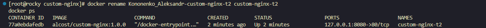
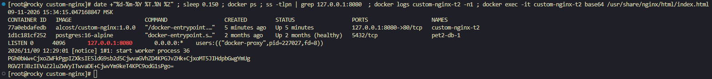
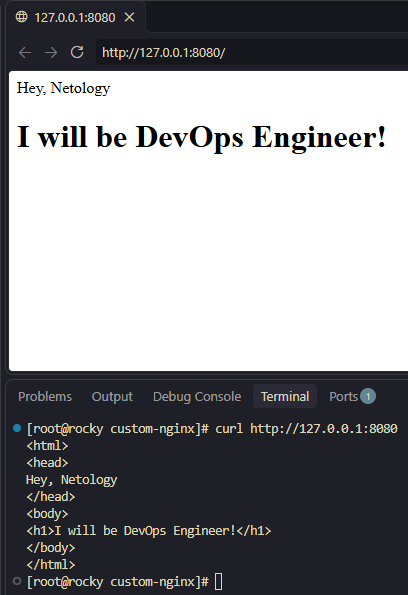
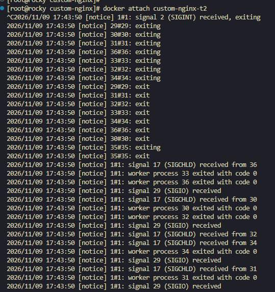
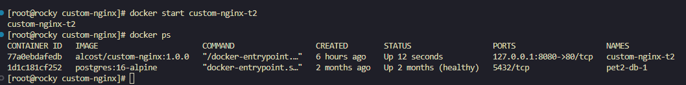
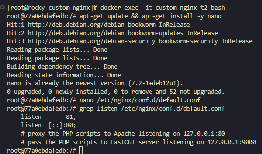

### Кононенко Александр домашнее задание по теме    "Оркестрация группой Docker контейнеров на примере Docker Compose"


### Задача 1

<details>
<summary><strong>Текст Задачи </strong></summary>

1. Установите Docker и Docker Compose Plugin на свою Linux рабочую станцию или ВМ.

2. Если Docker Hub недоступен, создайте файл `/etc/docker/daemon.json` с содержимым:

   ```json
   {
     "registry-mirrors": [
       "https://mirror.gcr.io",
       "https://daocloud.io",
       "https://c.163.com/",
       "https://registry.docker-cn.com"
     ]
   }
   ```

3. Зарегистрируйтесь и создайте публичный репозиторий с именем `custom-nginx` на [Docker Hub](https://hub.docker.com) (ТОЛЬКО ЕСЛИ У ВАС ЕСТЬ ДОСТУП).

4. Скачайте образ `nginx:1.29.0`.

5. Создайте Dockerfile и реализуйте в нём замену дефолтной индекс-страницы (`/usr/share/nginx/html/index.html`) на файл `index.html` с содержимым:

   ```html
   <html>
   <head>
   Hey, Netology
   </head>
   <body>
   <h1>I will be DevOps Engineer!</h1>
   </body>
   </html>
   ```

6. Соберите и отправьте созданный образ в свой Docker Hub репозиторий с тегом `1.0.0` (ТОЛЬКО ЕСЛИ ЕСТЬ ДОСТУП).

7. Предоставьте ответ в виде ссылки:

   `https://hub.docker.com/r/<username>/custom-nginx/general`

</details>

### Решение1


<details>
<summary><strong>Ссылка на решение </strong></summary>

[Docker Hub — custom-nginx](https://hub.docker.com/repository/docker/alcost/custom-nginx/general)

</details>


━━━━━━━━━━━━━━━━━━━━━━━━━━━━━━━━━━━━━━━━


### Задача 2

<details>
<summary><strong> Текст Задачи </strong></summary>

1. Запустите ваш образ `custom-nginx:1.0.0` командой `docker run` в соответствии с требованиями:

   - Имя контейнера: `ФИО-custom-nginx-t2`
   - Контейнер работает в фоновом режиме.
   - Контейнер опубликован на порту хост-системы `127.0.0.1:8080`.

2. Не удаляя контейнер, переименуйте его в `custom-nginx-t2`.

3. Выполните команду:

   ```bash
   date +"%d-%m-%Y %T.%N %Z" ; sleep 0.150 ; docker ps ; ss -tlpn | grep 127.0.0.1:8080  ; docker logs custom-nginx-t2 -n1 ; docker exec -it custom-nginx-t2 base64 /usr/share/nginx/html/index.html
   ```

4. Убедитесь с помощью `curl` или веб-браузера, что индекс-страница доступна.

**Результат выполнения:**

В качестве ответа приложите скриншоты консоли, где видно все введённые команды и их вывод.

</details>

━━━━━━━━━━━━━━━━━━━━━━━━━━━━━━━━━━━━━━━━


### Решение2


   #### Пункт 1

- <details>
  <summary><strong>Решение</strong></summary>

  

  </details>


 #### Пункт 2

- <details>
  <summary><strong>Решение</strong></summary>

  

  </details>


 #### Пункт 3

- <details>
  <summary><strong>Решение</strong></summary>

  

  </details>


 #### Пункт 4

- <details>
  <summary><strong>Решение</strong></summary>

  

  </details>

━━━━━━━━━━━━━━━━━━━━━━━━━━━━━━━━━━━━━━━━


### Задача 3

<details>
<summary><strong> Текст Задачи  задачи</strong></summary>

1. Воспользуйтесь `docker help` или Google, чтобы узнать, как подключиться к стандартным потокам ввода, вывода и ошибок контейнера `custom-nginx-t2`.
2. Подключитесь к контейнеру и нажмите комбинацию `Ctrl-C`.
3. Выполните команду `docker ps -a` и объясните своими словами, почему контейнер остановился.
4. Перезапустите контейнер.
5. Зайдите в интерактивный терминал контейнера `custom-nginx-t2` с оболочкой `bash`.
6. Установите любимый текстовый редактор (`vim`, `nano` и т. д.) с помощью `apt-get`.
7. Отредактируйте файл `/etc/nginx/conf.d/default.conf`, заменив порт `listen 80` на `listen 81`.
8. Запомните(!) и выполните команду `nginx -s reload`, а затем внутри контейнера выполните команды:


curl http://127.0.0.1:80 ; curl http://127.0.0.1:81
9. Выйдите из контейнера, набрав в консоли `exit` или нажав `Ctrl-D`.
10. Проверьте вывод команд:
 ```
 ss -tlpn | grep 127.0.0.1:8080
 docker port custom-nginx-t2
 curl http://127.0.0.1:8080
 ```
 Кратко объясните суть возникшей проблемы.
11. Это дополнительное, необязательное задание. Попробуйте самостоятельно исправить конфигурацию контейнера, используя доступные источники в интернете. Не изменяйте конфигурацию Nginx и не удаляйте контейнер. Останавливать контейнер можно. [Пример источника](https://www.baeldung.com/linux/assign-port-docker-container).
12. Удалите запущенный контейнер `custom-nginx-t2`, не останавливая его (воспользуйтесь `--help` или Google).

В качестве ответа приложите скриншоты консоли, где видно все введённые команды и их вывод.

</details>


━━━━━━━━━━━━━━━━━━━━━━━━━━━━━━━━━━━━━━━━

### Решение3

#### Пункты 1-3

- <details>
  <summary><strong>Решение</strong></summary>

  Для подключения к главному процессу запущенного контейнера используется команда **`docker attach`**.

  Она позволяет подключиться к стандартным потокам ввода и вывода (STDIN, STDOUT, STDERR) основного процесса контейнера и взаимодействовать с ним в реальном времени прямо из терминала.

  Когда я нажал `Ctrl + C`, nginx получил сигнал на завершение (SIGINT) и штатно остановился.

  По логам это видно.

  Контейнер остановился потому, что nginx был главным процессом контейнера (PID 1). А контейнер работает до тех пор, пока работает его главный процесс.

  

  </details>

   #### Пункт 4

- <details>
   <summary><strong>Решение</strong></summary>

  для   перезапуска  и просмотра  состояния  контейнера
   используются команды 
   **`docker start custom-nginx-t2`**
    **`docker ps`**

  

  </details>

#### Пункты 5-7

- <details>
  <summary><strong>Решение</strong></summary>

   * вход в интерактивный терминал контейнера  осуществляется командой  **`docker exec -it custom-nginx-t2 bash`**
   * установка редактора  nano   осуществляется командой   **`apt-get install -y nano`**
   *  правка конфига  осуществляется командой  **`nano /etc/nginx/conf.d/default.conf`**
 
  

   </details>
   
   
