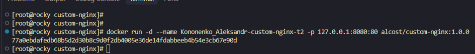

### Кононенко Александр домашнее задание по теме    "Оркестрация группой Docker контейнеров на примере Docker Compose"


### Задача 1

<details>
<summary><strong>Текст Задачи </strong></summary>

1. Установите Docker и Docker Compose Plugin на свою Linux рабочую станцию или ВМ.

2. Если Docker Hub недоступен, создайте файл `/etc/docker/daemon.json` с содержимым:

   ```json
   {
     "registry-mirrors": [
       "https://mirror.gcr.io",
       "https://daocloud.io",
       "https://c.163.com/",
       "https://registry.docker-cn.com"
     ]
   }
   ```

3. Зарегистрируйтесь и создайте публичный репозиторий с именем `custom-nginx` на [Docker Hub](https://hub.docker.com) (ТОЛЬКО ЕСЛИ У ВАС ЕСТЬ ДОСТУП).

4. Скачайте образ `nginx:1.29.0`.

5. Создайте Dockerfile и реализуйте в нём замену дефолтной индекс-страницы (`/usr/share/nginx/html/index.html`) на файл `index.html` с содержимым:

   ```html
   <html>
   <head>
   Hey, Netology
   </head>
   <body>
   <h1>I will be DevOps Engineer!</h1>
   </body>
   </html>
   ```

6. Соберите и отправьте созданный образ в свой Docker Hub репозиторий с тегом `1.0.0` (ТОЛЬКО ЕСЛИ ЕСТЬ ДОСТУП).

7. Предоставьте ответ в виде ссылки:

   `https://hub.docker.com/r/<username>/custom-nginx/general`

</details>

### Решение1


<details>
<summary><strong>Ссылка на решение </strong></summary>

[Docker Hub — custom-nginx](https://hub.docker.com/repository/docker/alcost/custom-nginx/general)

</details>

- - - 


### Задача 2

<details>
<summary><strong> Текст Задачи </strong></summary>

1. Запустите ваш образ `custom-nginx:1.0.0` командой `docker run` в соответствии с требованиями:

   - Имя контейнера: `ФИО-custom-nginx-t2`
   - Контейнер работает в фоновом режиме.
   - Контейнер опубликован на порту хост-системы `127.0.0.1:8080`.

2. Не удаляя контейнер, переименуйте его в `custom-nginx-t2`.

3. Выполните команду:

   ```bash
   date +"%d-%m-%Y %T.%N %Z" ; sleep 0.150 ; docker ps ; ss -tlpn | grep 127.0.0.1:8080  ; docker logs custom-nginx-t2 -n1 ; docker exec -it custom-nginx-t2 base64 /usr/share/nginx/html/index.html
   ```

4. Убедитесь с помощью `curl` или веб-браузера, что индекс-страница доступна.

**Результат выполнения:**

В качестве ответа приложите скриншоты консоли, где видно все введённые команды и их вывод.

</details>

### Решение2


   #### Пункт 1

- <details>
  <summary><strong>Решение</strong></summary>

  

  </details>


