### Кононенко Александр домашнее задание по теме    "Оркестрация группой Docker контейнеров на примере Docker Compose"


### Задача 1

<details>
<summary><strong>Текст Задачи </strong></summary>

1. Установите Docker и Docker Compose Plugin на свою Linux рабочую станцию или ВМ.

2. Если Docker Hub недоступен, создайте файл `/etc/docker/daemon.json` с содержимым:

   ```json
   {
     "registry-mirrors": [
       "https://mirror.gcr.io",
       "https://daocloud.io",
       "https://c.163.com/",
       "https://registry.docker-cn.com"
     ]
   }
   ```

3. Зарегистрируйтесь и создайте публичный репозиторий с именем `custom-nginx` на [Docker Hub](https://hub.docker.com) (ТОЛЬКО ЕСЛИ У ВАС ЕСТЬ ДОСТУП).

4. Скачайте образ `nginx:1.29.0`.

5. Создайте Dockerfile и реализуйте в нём замену дефолтной индекс-страницы (`/usr/share/nginx/html/index.html`) на файл `index.html` с содержимым:

   ```html
   <html>
   <head>
   Hey, Netology
   </head>
   <body>
   <h1>I will be DevOps Engineer!</h1>
   </body>
   </html>
   ```

6. Соберите и отправьте созданный образ в свой Docker Hub репозиторий с тегом `1.0.0` (ТОЛЬКО ЕСЛИ ЕСТЬ ДОСТУП).

7. Предоставьте ответ в виде ссылки:

   `https://hub.docker.com/r/<username>/custom-nginx/general`

</details>

### Решение1


<details>
<summary><strong>Ссылка на решение </strong></summary>

[Docker Hub — custom-nginx](https://hub.docker.com/repository/docker/alcost/custom-nginx/general)

</details>


━━━━━━━━━━━━━━━━━━━━━━━━━━━━━━━━━━━━━━━━


### Задача 2

<details>
<summary><strong> Текст Задачи </strong></summary>

1. Запустите ваш образ `custom-nginx:1.0.0` командой `docker run` в соответствии с требованиями:

   - Имя контейнера: `ФИО-custom-nginx-t2`
   - Контейнер работает в фоновом режиме.
   - Контейнер опубликован на порту хост-системы `127.0.0.1:8080`.

2. Не удаляя контейнер, переименуйте его в `custom-nginx-t2`.

3. Выполните команду:

   ```bash
   date +"%d-%m-%Y %T.%N %Z" ; sleep 0.150 ; docker ps ; ss -tlpn | grep 127.0.0.1:8080  ; docker logs custom-nginx-t2 -n1 ; docker exec -it custom-nginx-t2 base64 /usr/share/nginx/html/index.html
   ```

4. Убедитесь с помощью `curl` или веб-браузера, что индекс-страница доступна.

**Результат выполнения:**

В качестве ответа приложите скриншоты консоли, где видно все введённые команды и их вывод.

</details>

━━━━━━━━━━━━━━━━━━━━━━━━━━━━━━━━━━━━━━━━


### Решение2


   #### Пункт 1

- <details>
  <summary><strong>Решение</strong></summary>

  

  </details>


 #### Пункт 2

- <details>
  <summary><strong>Решение</strong></summary>

  

  </details>


 #### Пункт 3

- <details>
  <summary><strong>Решение</strong></summary>

  

  </details>


 #### Пункт 4

- <details>
  <summary><strong>Решение</strong></summary>

  

  </details>

━━━━━━━━━━━━━━━━━━━━━━━━━━━━━━━━━━━━━━━━


### Задача 3

<details>
<summary><strong> Текст Задачи </strong></summary>

1. Воспользуйтесь `docker help` или Google, чтобы узнать, как подключиться к стандартным потокам ввода, вывода и ошибок контейнера `custom-nginx-t2`.
2. Подключитесь к контейнеру и нажмите комбинацию `Ctrl-C`.
3. Выполните команду `docker ps -a` и объясните своими словами, почему контейнер остановился.
4. Перезапустите контейнер.
5. Зайдите в интерактивный терминал контейнера `custom-nginx-t2` с оболочкой `bash`.
6. Установите любимый текстовый редактор (`vim`, `nano` и т. д.) с помощью `apt-get`.
7. Отредактируйте файл `/etc/nginx/conf.d/default.conf`, заменив порт `listen 80` на `listen 81`.
8. Запомните(!) и выполните команду `nginx -s reload`, а затем внутри контейнера выполните команды:


curl http://127.0.0.1:80 ; curl http://127.0.0.1:81
9. Выйдите из контейнера, набрав в консоли `exit` или нажав `Ctrl-D`.
10. Проверьте вывод команд:
 ```
 ss -tlpn | grep 127.0.0.1:8080
 docker port custom-nginx-t2
 curl http://127.0.0.1:8080
 ```
 Кратко объясните суть возникшей проблемы.
11. Это дополнительное, необязательное задание. Попробуйте самостоятельно исправить конфигурацию контейнера, используя доступные источники в интернете. Не изменяйте конфигурацию Nginx и не удаляйте контейнер. Останавливать контейнер можно. [Пример источника](https://www.baeldung.com/linux/assign-port-docker-container).
12. Удалите запущенный контейнер `custom-nginx-t2`, не останавливая его (воспользуйтесь `--help` или Google).

В качестве ответа приложите скриншоты консоли, где видно все введённые команды и их вывод.

</details>


━━━━━━━━━━━━━━━━━━━━━━━━━━━━━━━━━━━━━━━━

### Решение3

#### Пункты 1-3

- <details>
  <summary><strong>Решение</strong></summary>

  Для подключения к главному процессу запущенного контейнера используется команда **`docker attach`**.

  Она позволяет подключиться к стандартным потокам ввода и вывода (STDIN, STDOUT, STDERR) основного процесса контейнера и взаимодействовать с ним в реальном времени прямо из терминала.

  Когда я нажал `Ctrl + C`, nginx получил сигнал на завершение (SIGINT) и штатно остановился.

  По логам это видно.

  Контейнер остановился потому, что nginx был главным процессом контейнера (PID 1). А контейнер работает до тех пор, пока работает его главный процесс.

  

  </details>

   #### Пункт 4

- <details>
   <summary><strong>Решение</strong></summary>

  для   перезапуска  и просмотра  состояния  контейнера
   используются команды 
   **`docker start custom-nginx-t2`**
    **`docker ps`**

  

  </details>

#### Пункты 5-7

- <details>
  <summary><strong>Решение</strong></summary>

   * вход в интерактивный терминал контейнера  осуществляется командой  **`docker exec -it custom-nginx-t2 bash`**
   * установка редактора  nano   осуществляется командой   **`apt-get install -y nano`**
   *  правка конфига  осуществляется командой  **`nano /etc/nginx/conf.d/default.conf`**
 
  

   </details>

    #### Пункт 10

- <details>
   <summary><strong>Решение</strong></summary>
  
   проблема возникла  из за того что  конфигурации  docker   и  nginx  перестали совпадать 
   дело в том что проброс портов настраивается при создании контейнера 
   и сам по себе не изменяется  docker  посылает пакеты  с 8080 на 80 внутри контейнера   
   но после правки конфига  nginx   слушает уже 81 порт  а на 80  пусто
  

  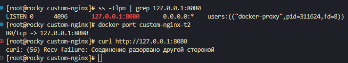

  </details>


  #### Пункт 11

- <details>
   <summary><strong>Решение</strong></summary>
    
   удаление контейнера происходит командой **`docker rm -f custom-nginx-t2`**

     просмотр контейнеров происходит командой **`docker ps -a`**
  

  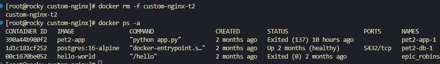

  </details>
━━━━━━━━━━━━━━━━━━━━━━━━━━━━━━━━━━━━━━━━

   ### Задача 4

<details>
<summary><strong> Текст Задачи</strong></summary>

1. Запустите первый контейнер из образа **`centos`** с любым тегом в фоновом режиме, подключив текущий рабочий каталог `$(pwd)` на хостовой машине в `/data` контейнера, используя ключ `-v`.
2. Запустите второй контейнер из образа **`debian`** в фоновом режиме, подключив текущий рабочий каталог `$(pwd)` в `/data` контейнера.
3. Подключитесь к первому контейнеру с помощью `docker exec` и создайте текстовый файл любого содержания в `/data`.
4. Добавьте ещё один файл в текущий каталог `$(pwd)` на хостовой машине.
5. Подключитесь ко второму контейнеру и отобразите листинг и содержимое файлов в `/data` контейнера.

В качестве ответа приложите скриншоты консоли, где видны все введённые команды и их вывод.
</details>


### Решение 4

 #### Пункты 1-2

- <details>
  <summary><strong>Решение</strong></summary>

  запуск контейнеров из образов происходит следующими командами

  **`docker run -d --name centos-t4 -v $(pwd):/data centos:7 sleep infinity`**

   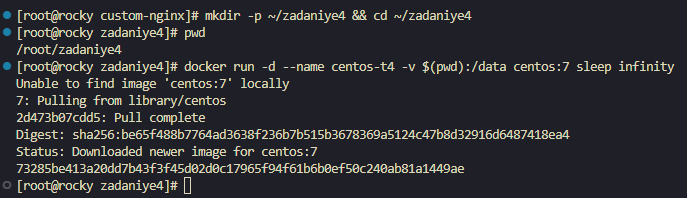

 

  **`docker run -d --name debian-t4 -v $(pwd):/data debian sleep infinity`**

  

   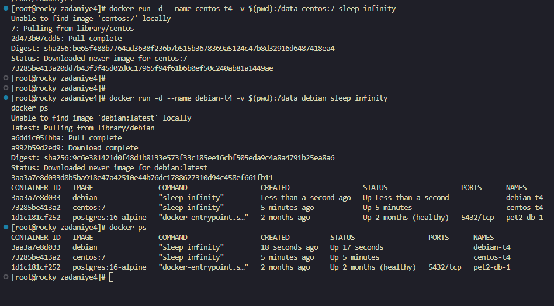

 </details>

 #### Пункты 3-5

- <details>
  <summary><strong>Решение</strong></summary>
   
   * команда  создания файла внутри  centos   **`docker exec centos-t4 bash -c 'echo "Test centos" > /data/from-centos.txt'`**
   * команда создания файла  на хостовой машине  **`echo "Test host" > ~/zadaniye4/from-host.txt`**
   * команда показывает из debian какие фаилы лежат в /data  **`docker exec debian-t4 ls -la /data`**
   * команда показывает содержимое файлов из  debian **`docker exec debian-t4 bash -c 'cat /data/*.txt'`**
   
   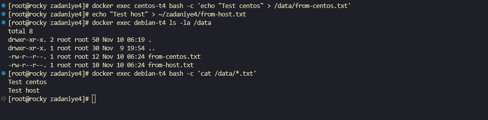

  </details>

━━━━━━━━━━━━━━━━━━━━━━━━━━━━━━━━━━━━━━━━

### Задача 5

<details>
<summary><strong> Текст Задачи</strong></summary>

1. Создайте отдельную директорию (например, `/tmp/netology/docker/task5`) и два файла внутри неё.

   Файл `compose.yaml` со следующим содержимым:

   ```yaml
   version: "3"
   services:
     portainer:
       network_mode: host
       image: portainer/portainer-ce:latest
       volumes:
         - /var/run/docker.sock:/var/run/docker.sock
     ```


 Файл docker-compose.yaml со следующим содержимым:


```yaml
   
   version: "3"
  services:
  registry:
    image: registry:2
    ports:
      - "5000:5000"
 ```

И выполните команду "docker compose up -d". Какой из файлов был запущен и почему? (подсказка: https://docs.docker.com/compose/compose-application-model/#the-compose-file )


 2. Отредактируйте файл compose.yaml так, чтобы были запущенны оба файла. (подсказка: https://docs.docker.com/compose/compose-file/14-include/)

3.  Выполните в консоли вашей хостовой ОС необходимые команды чтобы залить образ custom-nginx как custom-nginx:latest в запущенное вами, локальное registry. Дополнительная документация:              https://distribution.github.io/distribution/about/deploying/

4. Откройте страницу "https://127.0.0.1:9000" и произведите начальную настройку portainer.(логин и пароль адмнистратора)

5. Откройте страницу "http://127.0.0.1:9000/#!/home", выберите ваше local окружение. Перейдите на вкладку "stacks" и в "web editor" и задеплойте  следующий компоуз  

 
 ``` yaml

version: '3'

services:
  nginx:
    image: 127.0.0.1:5000/custom-nginx
    ports:
      - "9090:80"
```


 6.Перейдите на страницу "http://127.0.0.1:9000/#!/2/docker/containers", выберите контейнер с nginx и нажмите на кнопку "inspect". В представлении <> Tree разверните поле "Config" и сделайте скриншот от поля "AppArmorProfile" до "Driver".

 7. Удалите любой из манифестов компоуза(например compose.yaml). Выполните команду "docker compose up -d". Прочитайте warning, объясните суть предупреждения и выполните предложенное действие. Погасите compose-проект ОДНОЙ(обязательно!!)    командой.

 В качестве ответа приложите скриншоты консоли, где видно все введенные команды и их вывод, файл compose.yaml , скриншот portainer c задеплоенным компоузом.

</details>


 #### Пункт 1

- <details>
  <summary><strong>Решение</strong></summary>

  - Команда для создания папки:

    **`mkdir -p /tmp/netology/docker/task5 && cd /tmp/netology/docker/task5`**

  - Команда для создания файла `compose.yaml`:

    **`nano compose.yaml`**

    ```yaml
    version: "3"
    services:
      portainer:
        network_mode: host
        image: portainer/portainer-ce:latest
        volumes:
          - /var/run/docker.sock:/var/run/docker.sock
    ```

  - Команда для создания файла `docker-compose.yaml`:

    **`nano docker-compose.yaml`**

    ```yaml
    version: "3"
    services:
      registry:
        image: registry:2
        ports:
          - "5000:5000"
    ```
 
  на скрине видно что запустился  Portainer это произошло поточу что когда указываешь  **`docker compose up -d`**  без указания  имени файла 
  compouse  сам ищет файл  с одним из стандартных имён 
  порядок поиска 
  * compose.yaml
  * compose.yml
  * docker-compose.yaml
  * docker-compose.yml
 исходя из этого берется первый найденный файл и запускается  


  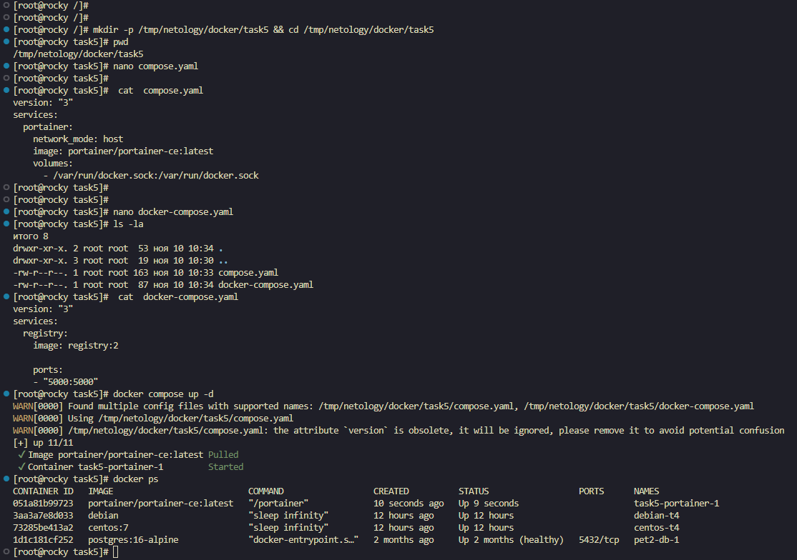


</details>


#### Пункт 2

- <details>
  <summary><strong>Решение</strong></summary>

  Для того чтобы запустились оба контейнера, нужно отредактировать файл **`compose.yaml`** и добавить ключ **`include`**, указав в нём `docker-compose.yaml`.

  Тогда Compose подключает второй файл и запускает сервисы из обоих файлов: `portainer` и `registry`.

  ```yaml
  include:
    - docker-compose.yaml

  services:
    portainer:
      network_mode: host
      image: portainer/portainer-ce:latest
      volumes:
        - /var/run/docker.sock:/var/run/docker.sock
  ```

  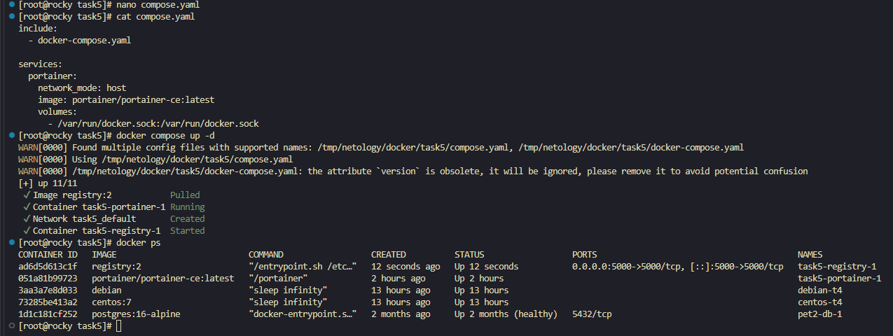


#### Пункт 3

- <details>
  <summary><strong>Решение</strong></summary>

  Для выполнения задания необходима следующая команда:

  **`docker tag alcost/custom-nginx:1.0.0 127.0.0.1:5000/custom-nginx:latest`**

  Эта команда присваивает образу дополнительное имя `127.0.0.1:5000/custom-nginx:latest`.

  Префикс `127.0.0.1:5000/` указывает адрес локального Registry куда Docker отправит образ при выполнении `push`.

  `custom-nginx` — это имя образа.

  `latest` — тег образа.

  Новый образ при этом не создаётся: оба имени указывают на один и тот же `IMAGE ID`.


  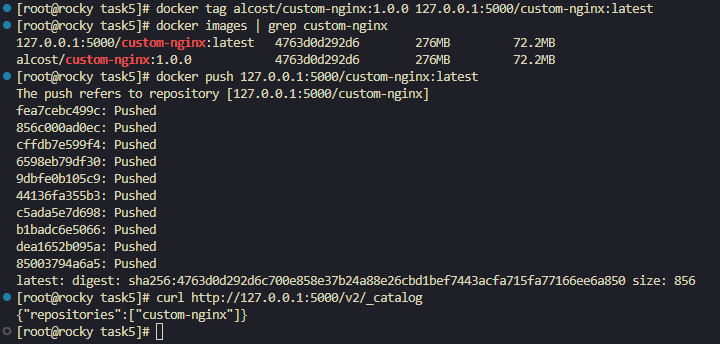

  </details>

#### Пункт 4

- <details>
  <summary><strong>Скрин Решения </strong></summary>

  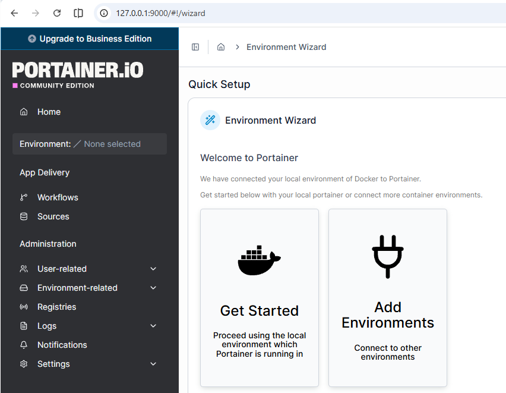

  </details>

#### Пункт 5

- <details>
  <summary><strong> Скрин Решения </strong></summary>
  
   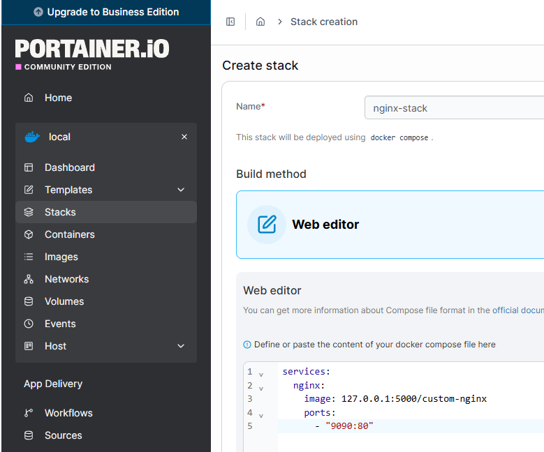

   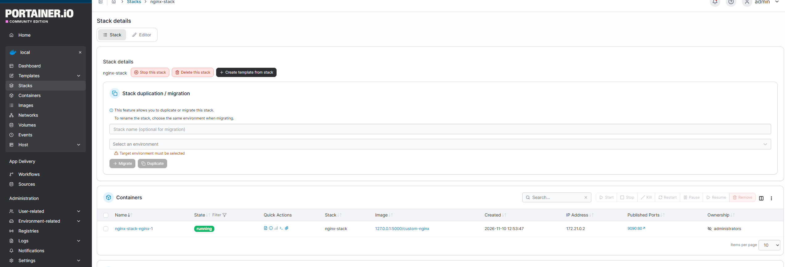

  </details>

 #### Пункт 6

- <details>
  <summary><strong> Скрин Решения </strong></summary>
 
  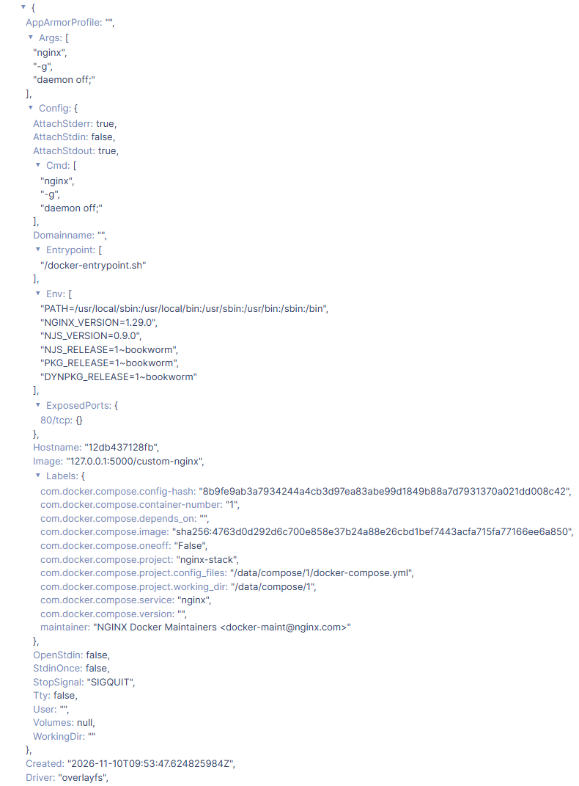
 
  </details>

#### Пункт 7

- <details>
  <summary><strong>Решение</strong></summary>

  После удаления `compose.yaml` и повторного запуска `docker compose up -d` появилось предупреждение о контейнере-сироте (orphan container) `task5-portainer-1`.

  Сервис `portainer` был описан в удалённом `compose.yaml` поэтому в текущей конфигурации проекта его больше нет.

  Но контейнер продолжает работать и по-прежнему считается частью проекта `task5`.

  Compose не удаляет такие контейнеры самостоятельно и предлагает запустить команду с флагом `--remove-orphans` чтобы убрать контейнеры которых нет в Compose-файле.

  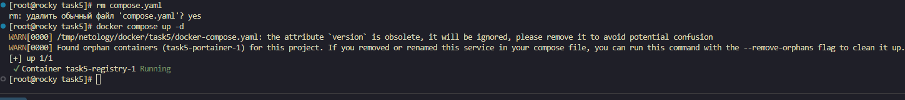

выполнение  команд 
* **`docker compose up -d --remove-orphans`**
* **`docker ps`**
* **`docker compose down`**
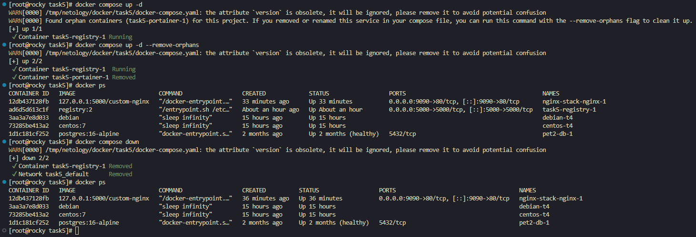

  </details>
  
